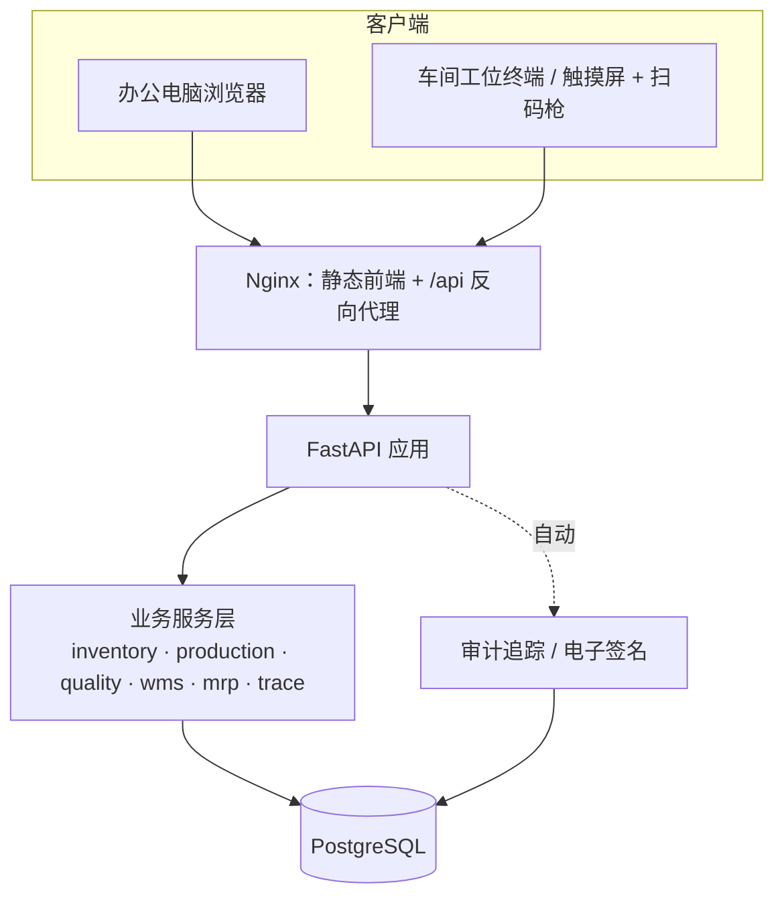

# 系统架构与业务规则

## 总体架构

- **单体应用 + 单一数据库**：ERP/MES/WMS/QMS 同库，避免系统间接口和数据不一致；按业务域划分模块，后续可平滑拆分。
- **所有库存变动只走 `services/inventory.py`**：余额与流水在同一事务内更新，库存不会“对不上”。
- **审计追踪在 ORM 层统一实现**（`audit.py`，`after_flush` 钩子），任何功能新增的数据都自动有审计记录。
- **时间戳由服务器生成**（工厂本地时区），客户端不能指定。

## 数据模型（46 张表）

| 域 | 主要表 |
|---|---|
| 系统 | `sys_user` 用户、`sys_audit_log` 审计追踪、`sys_esignature` 电子签名、`sys_sequence` 单据编号 |
| 主数据 | `md_customer` 客户（注册人/质量协议）、`md_supplier` 合格供方、`md_material` 物料（含光疗/UDI/客供属性）、`md_work_center`、`md_equipment` + `md_calibration`、`md_warehouse`、`md_location` |
| 工程 | `eng_bom` / `eng_bom_line`、`eng_routing` / `eng_routing_op` / `eng_routing_param`（测试规格） |
| ERP | `erp_sales_order(+_line)`、`erp_purchase_order(+_line)`、`erp_mrp_run` / `erp_mrp_suggestion`、`fin_doc` / `fin_payment` |
| WMS | `wms_stock`（物料+库位+批次+质量状态+货主）、`wms_stock_move` 流水、`wms_receipt(+_line)`、`wms_issue(+_line)`、`wms_shipment(+_line)`、`wms_stock_count(+_line)` |
| MES | `mes_work_order`、`mes_wo_material`（用料快照）、`mes_wo_operation`（工序/规格快照）、`mes_serial`（序列号/UDI）、`mes_op_record` 过站记录、`mes_test_value` 测试数据、`mes_key_part` 关键件绑定 |
| QMS | `qms_inspection(+_item)`、`qms_ncr`、`qms_capa` |

## 关键业务规则（均由后端强制执行，并有自动化测试覆盖）

**主数据 / 工程**
- GTIN 校验 GS1 校验位；只有成品/半成品可启用序列号；成品不能是客供料。
- BOM / 工艺：草稿可改 → 电子签名发布（旧版本自动作废）→ 已发布不可改，只能升版；BOM 循环引用与自引用检查。
- 被单据引用的主数据不能删除，只能停用。

**销售 / 采购 / MRP**
- 代工产品只能销售给其所属品牌客户；客供料不能采购。
- 采购订单审批：供应商必须是“合格供方”且资质未过期。
- 收货超收上限 5%；收货自动生成应付；发货自动生成应收。
- MRP：低阶码逐层展开；净需求 = 毛需求 + 安全库存 − 库存（合格+待检）− 在途 − 在制；最小订货量、提前期倒排；建议一键转采购订单（按默认供应商合并）/ 生产工单。

**WMS**
- 库存质量状态：待检/待放行（QUARANTINE）、合格（AVAILABLE）、不合格（REJECTED）、冻结（HOLD）；只有合格库存可领用和发货。
- FEFO：按有效期 → 入库时间排序推荐批次；过期批次不可用；不合格品区的库存不参与分配。
- 客供料：按货主隔离，只能分配给该客户的工单。
- 盘点：生成账面快照 → 录入实盘 → 过账自动生成差异调整。

**MES**
- 工单下达：快照已发布 BOM（含损耗，离散单位向上取整）与工艺（含测试规格）；生成批号、序列号、UDI。
- 过站防呆：只能做“下一道工序”；指定工位时不匹配即拦截（防跳站/重复过站）。
- 需设备的工序必须选择设备；设备非正常状态或校准过期即拦截。
- 测试项必须全部录入；超出规格上下限系统判不合格（操作员无法改判合格）；不合格自动开 NCR，产品状态变为 NG，处置前不能继续。
- 关键件工序必须扫描关键件批号/序列号，且批号必须是已领用到本工单的批次。
- 批量报工（非序列号产品）：本工序合格+不合格 ≤ 上道工序合格数。
- 完工入库：成品状态为“待放行”。

**QMS**
- IQC：GB/T 2828.1 正常检验一次抽样、一般检验水平 II，按批量与 AQL 自动给出 n/Ac/Re（含箭头规则）；不良数 > Ac 或有不合格项 → 不合格；让步接收只能由 QA 批准；判定需电子签名并自动转换库存状态、自动开 NCR。
- NCR 处置（QA 电子签名）：生产过程不合格只能返工/报废；来料不合格可让步/挑选重检/退货/报废，库存随之自动变化。
- DHR 放行检查：工单已完工、物料足额领用、无未处置 NCR、完工全部入库 → 才能电子签名放行；放行后批次库存转为合格、工单关闭。

## API 概览

启动后访问 `/api/docs`（Swagger，中文分组）。主要分组：认证、系统管理、主数据-*、工程-BOM、工程-工艺路线、销售、采购、计划-MRP、财务、仓储WMS、生产MES、质量QMS、驾驶舱/追溯、数据导入。
