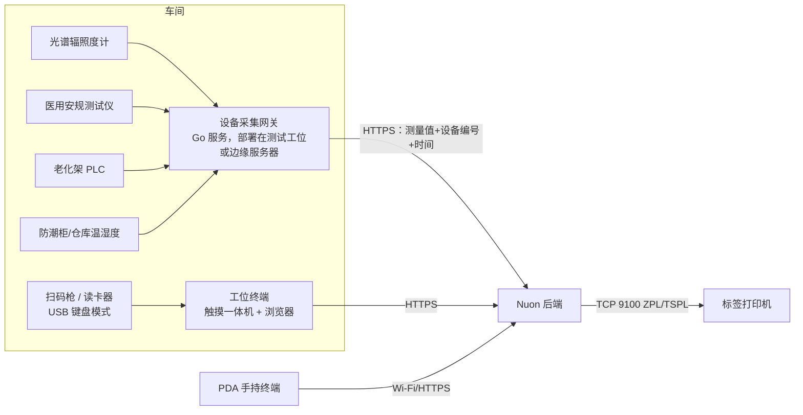

# 硬件对接清单（光疗医疗器械代工厂）

原则：**能用“键盘模式”的设备先用键盘模式（零开发）**；需要读数的仪器通过“设备采集网关”统一对接，业务系统不直接连设备。

## 一、第一批：上线即需要（基本零开发）

| 设备 | 用途 | 对接方式 | 选型建议 | 系统现状 |
|---|---|---|---|---|
| **二维条码扫描枪** | 扫序列号/UDI、批号、单号、库位 | USB HID 键盘模式，扫描后自动回车 | 必须能读 **GS1 DataMatrix**（UDI 二维码），如霍尼韦尔、斑马、新大陆的 2D 扫描枪 | ✅ 已支持（工位终端、发货、追溯、全局搜索均可直接扫） |
| **工牌读卡器** | 工位刷卡切换操作员（Part 11 记录归属） | USB HID 键盘模式（读出卡号 + 回车） | 与现有门禁/考勤卡同频段（ID 125kHz 或 IC 13.56MHz） | 🔧 开发中（工牌登录 + 工位锁屏） |
| **工位终端** | 每个工位扫码报工、录入测试值 | 浏览器访问系统 | 15–21 寸触摸一体机或工控平板，带 USB 口 | ✅ 已支持 |
| **标签打印机** | UDI 铭牌/彩盒/外箱标签、物料批次标签、库位标签 | 网口直连，系统直接发送 ZPL/TSPL 指令到 TCP 9100（无需驱动） | 斑马 Zebra（ZPL）或 TSC（TSPL）工业机，300dpi；铭牌用耐刮/耐酒精标签材料 | ⏳ 待开发（需各品牌客户的标签模板） |
| **PDA 手持终端** | 收货、上架、拣料、盘点、发货扫码 | 安卓 PDA 浏览器访问系统（后续可做专用移动页面） | 带工业扫描头的安卓 PDA（斑马、霍尼韦尔、优博讯、东集等） | ✅ 可先用浏览器；⏳ 移动端专用页面待开发 |

## 二、第二批：测试仪器自动采集（质量价值最高）

手工抄录测试值是 GMP 审核和客户审核的常见关注点；自动采集同时消除抄写错误、可追溯到仪器编号。

| 设备 | 采集内容 | 常见接口/协议 | 对接要点 |
|---|---|---|---|
| **光谱辐照度计 / 积分球光谱系统** | 峰值波长、辐照度、光谱分布、色坐标 | USB/RS232/LAN，厂商 SDK 或 SCPI 指令；部分只能导出 CSV | 需要厂商的 SDK/通讯协议文档；网关读取测量结果 → 自动填入工位终端的测试项 → 操作员确认提交 |
| **医用安规综合测试仪** | 耐压漏电流、接地电阻、对地/患者漏电流 | RS232/USB/LAN，大多支持 SCPI 类指令（可远程启动测试并取回结果） | 测试程序由仪器保存，网关只“启动+取结果”；结果附带仪器编号，系统已有的“校准过期禁止使用”规则继续生效 |
| **老化架 / 老化房控制器** | 每个工位的通电时长、电流、温度、异常断电 | PLC（Modbus TCP/RTU）或控制器自带软件的数据库/接口 | 自动判定老化时长是否达标；异常工位自动生成 NCR |
| **表面温度测量**（热电偶/测温仪） | 治疗面板与患者接触面温度 | RS232/USB 或手工录入 | 视产品标准和客户要求 |
| **激光功率计**（如有激光类产品） | 输出功率 | USB/RS232 | 同上 |

**需要你们提供**：现有仪器的 **品牌、型号、接口类型、是否有 SDK/通讯协议文档**（向仪器厂商索取），每个测试工位的电脑情况（Windows/Linux、是否联网）。

## 三、仓储环境

| 设备 | 用途 | 对接方式 |
|---|---|---|
| **防潮柜温湿度监控** | 湿敏 LED（MSL）存放条件；开柜/出柜时间用于计算车间暴露寿命 | 温湿度传感器 RS485/Modbus 或防潮柜厂商云平台 API → 超限报警、记录归档 |
| **仓库/成品库温湿度记录仪** | 储存条件记录（GMP 要求） | 同上，或定期导入记录仪数据 |
| **电子秤**（可选） | 螺丝等小件按重量计数（领料、盘点） | RS232/USB 读数 |

## 四、产线设备（第三批，按需）

| 设备 | 用途 | 对接方式 |
|---|---|---|
| **SMT 贴片机** | 上料防错（扫料盘条码核对料站表）、抛料统计 | 厂商 MES 接口/日志文件；初期做“扫码核对料站表”即可 |
| **AOI / SPI** | 检测结果进入制程记录 | 结果文件（CSV/XML）导入 |
| **回流焊** | 炉温曲线存档 | 炉温测试仪导出文件 |
| **智能电批** | 关键螺丝扭力记录（医疗器械装配常见要求） | RS232/以太网输出每颗螺丝扭力、角度、结果 |
| **激光打标机**（如铭牌直接打标） | 外壳直接标刻 UDI | 厂商软件接口或串口下发内容 |
| **车间看板大屏** | 产出、直通率、异常实时展示 | 电视 + 浏览器打开系统看板页（无需对接） |

## 五、基础设施

| 项目 | 要求 |
|---|---|
| 服务器 | 1 台（或私有云虚拟机）：4 核 / 16GB / SSD 500GB 起；生产数据库建议独立磁盘 |
| 备份 | NAS 或异地存储，保存数据库每日备份与附件 |
| UPS | 服务器、网络设备、测试工位电脑 |
| 网络 | 测试工位有线网；仓库/车间 Wi-Fi 覆盖（PDA）；本系统服务器与 **金蝶云星空服务器** 网络互通（账号登录） |
| 时间同步 | 所有服务器、工位电脑、仪器（如支持）同步到同一 NTP 时间源（电子记录时间戳要求） |

## 六、建议推进顺序

1. **上线前**：扫码枪（确认能读 DataMatrix）、工位一体机、工牌读卡器、网络与服务器 —— 这些到位系统即可运行。
2. **试运行期间**：标签打印（先做 UDI 铭牌和外箱标签，需要各客户的标签规格）、PDA。
3. **第二阶段**：光谱辐照度计 → 安规测试仪 → 老化架自动采集（按测试工位数量和仪器协议难度排序）；防潮柜温湿度。
4. **第三阶段**：SMT 上料防错、智能电批扭力、AOI 结果导入。

设备采集网关建议用 **Go** 开发（单文件部署、串口/Modbus/TCP 生态成熟、资源占用小），正好发挥你们团队的 Go 能力；它只通过 HTTPS 调用本系统接口，与业务代码解耦。

## 七、预算参考（估算，需向厂商询价确认）

> 多数测试仪器厂商不公开报价（“面议”），下表为市场区间估算，仅用于立项预算。示例配置：1 条总装线 = 2 个光学测试工位、1 个安规工位、1 间老化房（4 个老化架）、6 个工位终端。

| 项目 | 单价估算（人民币） | 示例数量 | 小计 |
|---|---|---|---|
| 光学测试：生产级光纤光谱仪 + 余弦校正器 + 辐照度定标 + 测试工装（波长须覆盖 400–1000nm，含 850nm） | 3–8 万/套 | 2 | 6–16 万 |
| 医用安规综合测试仪（耐压/接地/泄漏电流，符合 GB 9706.1-2020，带 LAN/RS232 与协议文档） | 国产 2–8 万；进口 8–20 万 | 1 | 2–8 万 |
| 老化架数据采集改造（Modbus 采集模块 + 电流检测） | 0.2–0.8 万/架 | 4 | 0.8–3.2 万 |
| 工位触摸一体机 | 0.3–0.6 万 | 6 | 1.8–3.6 万 |
| 二维扫描枪（支持 GS1 DataMatrix） | 500–2,000 | 6 | 0.3–1.2 万 |
| 工牌读卡器（USB 键盘模式） | 50–200 | 6 | 0.03–0.12 万 |
| 标签打印机：工业型 300dpi（斑马 ZT411 级）+ 桌面型各 1 | 工业 1.3–1.6 万；桌面 0.4–0.6 万 | 2 | 1.7–2.2 万 |
| PDA 手持终端 | 0.25–0.5 万 | 2 | 0.5–1 万 |
| 温湿度传感器（RS485/Modbus） | 200–800 | 6 | 0.12–0.48 万 |
| **合计** | | | **约 13–36 万** |

另需考虑：
- **可选：实验室级高精度光谱辐射计 1 台**（用作基准、来料抽测、与客户对测），约 10–30 万（估算）。没必要每个工位都买实验室级。
- **年度校准**：光谱类仪器需辐照度/波长溯源校准，安规仪器需计量校准，每台每年约数千元（估算，视机构而定）。
- **方法验证**：新测试设备投入使用前需做测试方法验证（重复性、与客户/第三方实验室比对），属于质量体系工作量。
- **软件开发**：设备采集网关由团队自行开发（Go），有协议文档时每类仪器约 1–2 周。

### 采购时必须写进技术协议的条款（决定能否接入本系统）

1. 提供 **LAN（优先）/USB/RS232 接口**，并随机提供**完整通讯协议文档或 SDK**（含远程启动测试、读取结果的指令），不能只能用厂商 PC 软件看报告。
2. 光谱类：波长范围覆盖全部产品波段（蓝光 460nm、红光 630/660nm、近红外 850nm 等），**辐照度绝对定标并提供可溯源（CNAS）校准证书**，带余弦校正。
3. 安规类：符合 **GB 9706.1-2020 / IEC 60601-1** 的泄漏电流测量网络，支持患者漏电流、BF/CF 型应用部分。
4. 提供本地校准服务；先**借样机联调**，确认能稳定取数后再下单。
5. 先盘点**现有仪器**：很多已带 RS232/USB 并有协议，直接对接比换新便宜得多。
