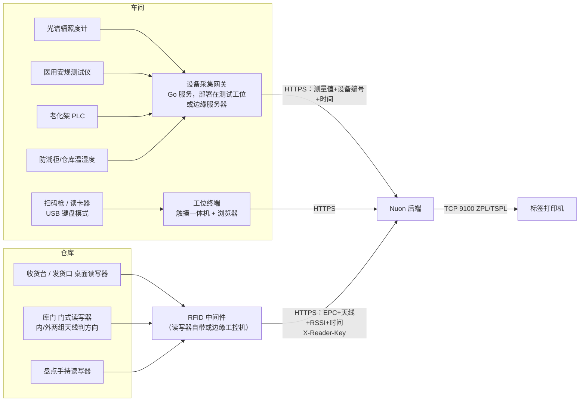

# 硬件对接清单（光疗医疗器械代工厂）

原则：**能用“键盘模式”的设备先用键盘模式（零开发）**；需要读数的仪器通过“设备采集网关”统一对接，业务系统不直接连设备。

> **2026-11 变更：仓库不再使用 PDA 扫码，改用 RFID**（收货台、库门、发货口固定读写器 + 盘点手持读写器，见第九节）。车间工位终端继续用扫码枪；条码保留为仓库的兜底手段。



## 一、第一批：上线即需要（基本零开发）

| 设备 | 用途 | 对接方式 | 选型建议 | 系统现状 |
|---|---|---|---|---|
| **二维条码扫描枪** | 扫序列号/UDI、批号、单号、库位 | USB HID 键盘模式，扫描后自动回车 | 必须能读 **GS1 DataMatrix**（UDI 二维码），如霍尼韦尔、斑马、新大陆的 2D 扫描枪 | ✅ 已支持（工位终端、追溯、全局搜索；仓库作为 RFID 标签读不到时的兜底） |
| **工牌读卡器** | 工位刷卡切换操作员（Part 11 记录归属） | USB HID 键盘模式（读出卡号 + 回车） | 与现有门禁/考勤卡同频段（ID 125kHz 或 IC 13.56MHz） | 🔧 开发中（工牌登录 + 工位锁屏） |
| **工位终端** | 每个工位扫码报工、录入测试值 | 浏览器访问系统 | 15–21 寸触摸一体机或工控平板，带 USB 口 | ✅ 已支持 |
| **标签打印机** | UDI 铭牌/彩盒/外箱标签、物料批次标签、库位标签 | 网口直连，系统直接发送 ZPL/TSPL 指令到 TCP 9100（无需驱动） | 斑马 Zebra（ZPL）或 TSC（TSPL）工业机，300dpi；铭牌用耐刮/耐酒精标签材料 | ⏳ 待开发（需各品牌客户的标签模板） |
| **仓库 RFID 读写器** | 收货发卡、过门调拨、领料/发货核对、盘点（取代 PDA 逐个扫码） | 读写器/中间件 → `POST /api/rfid/readings`（第九节） | 超高频 UHF（EPC Gen2 / ISO 18000-6C）；收货台、库门、发货口固定式，盘点 1 把手持 | ✅ 系统已支持（含模拟读取演示）；⏳ 现场选型、实物测标签、中间件联调 |

## 二、第二批：测试仪器自动采集（质量价值最高）

手工抄录测试值是 GMP 审核和客户审核的常见关注点；自动采集同时消除抄写错误、可追溯到仪器编号。

| 设备 | 采集内容 | 常见接口/协议 | 对接要点 |
|---|---|---|---|
| **光谱辐照度计 / 积分球光谱系统** | 峰值波长、辐照度、光谱分布、色坐标 | USB/RS232/LAN，厂商 SDK 或 SCPI 指令；部分只能导出 CSV | 需要厂商的 SDK/通讯协议文档；网关读取测量结果 → 自动填入工位终端的测试项 → 操作员确认提交 |
| **医用安规综合测试仪** | 耐压漏电流、接地电阻、对地/患者漏电流 | RS232/USB/LAN，大多支持 SCPI 类指令（可远程启动测试并取回结果） | 测试程序由仪器保存，网关只“启动+取结果”；结果附带仪器编号，系统已有的“校准过期禁止使用”规则继续生效 |
| **老化架 / 老化房控制器** | 每个工位的通电时长、电流、温度、异常断电 | PLC（Modbus TCP/RTU）或控制器自带软件的数据库/接口 | 自动判定老化时长是否达标；异常工位自动生成 NCR |
| **表面温度测量**（热电偶/测温仪） | 治疗面板与患者接触面温度 | RS232/USB 或手工录入 | 视产品标准和客户要求 |
| **激光功率计**（如有激光类产品） | 输出功率 | USB/RS232 | 同上 |

**需要你们提供**：现有仪器的 **品牌、型号、接口类型、是否有 SDK/通讯协议文档**（向仪器厂商索取），每个测试工位的电脑情况（Windows/Linux、是否联网）。

## 三、仓储环境

| 设备 | 用途 | 对接方式 |
|---|---|---|
| **防潮柜温湿度监控** | 湿敏 LED（MSL）存放条件；开柜/出柜时间用于计算车间暴露寿命 | 温湿度传感器 RS485/Modbus 或防潮柜厂商云平台 API → 超限报警、记录归档 |
| **仓库/成品库温湿度记录仪** | 储存条件记录（GMP 要求） | 同上，或定期导入记录仪数据 |
| **电子秤**（可选） | 螺丝等小件按重量计数（领料、盘点） | RS232/USB 读数 |

## 四、产线设备（第三批，按需）

| 设备 | 用途 | 对接方式 |
|---|---|---|
| **SMT 贴片机** | 上料防错（扫料盘条码核对料站表）、抛料统计 | 厂商 MES 接口/日志文件；初期做“扫码核对料站表”即可 |
| **AOI / SPI** | 检测结果进入制程记录 | 结果文件（CSV/XML）导入 |
| **回流焊** | 炉温曲线存档 | 炉温测试仪导出文件 |
| **智能电批** | 关键螺丝扭力记录（医疗器械装配常见要求） | RS232/以太网输出每颗螺丝扭力、角度、结果 |
| **激光打标机**（如铭牌直接打标） | 外壳直接标刻 UDI | 厂商软件接口或串口下发内容 |
| **车间看板大屏** | 产出、直通率、异常实时展示 | 电视 + 浏览器打开系统看板页（无需对接） |

## 五、基础设施

| 项目 | 要求 |
|---|---|
| 服务器 | 1 台（或私有云虚拟机）：4 核 / 16GB / SSD 500GB 起；生产数据库建议独立磁盘 |
| 备份 | NAS 或异地存储，保存数据库每日备份与附件 |
| UPS | 服务器、网络设备、测试工位电脑 |
| 网络 | 测试工位有线网；仓库固定读写器有线网（PoE 供电优先），手持读写器所在区域 Wi-Fi 覆盖；本系统服务器与 **金蝶云星空服务器** 网络互通（账号登录） |
| 时间同步 | 所有服务器、工位电脑、仪器（如支持）同步到同一 NTP 时间源（电子记录时间戳要求） |

## 六、建议推进顺序

1. **上线前**：扫码枪（确认能读 DataMatrix）、工位一体机、工牌读卡器、网络与服务器 —— 这些到位系统即可运行。
2. **试运行期间**：标签打印（先做 UDI 铭牌和外箱标签，需要各客户的标签规格）；仓库 RFID（先拿实物测标签 → 收货台 + 盘点手持 → 库门 → 发货口，见第九节）。
3. **第二阶段**：光谱辐照度计 → 安规测试仪 → 老化架自动采集（按测试工位数量和仪器协议难度排序）；防潮柜温湿度。
4. **第三阶段**：SMT 上料防错、智能电批扭力、AOI 结果导入。

设备采集网关建议用 **Go** 开发（单文件部署、串口/Modbus/TCP 生态成熟、资源占用小），正好发挥你们团队的 Go 能力；它只通过 HTTPS 调用本系统接口，与业务代码解耦。

## 七、预算参考（估算，需向厂商询价确认）

> 多数测试仪器厂商不公开报价（“面议”），下表为市场区间估算，仅用于立项预算。示例配置：1 条总装线 = 2 个光学测试工位、1 个安规工位、1 间老化房（4 个老化架）、6 个工位终端。

| 项目 | 单价估算（人民币） | 示例数量 | 小计 |
|---|---|---|---|
| 光学测试：生产级光纤光谱仪 + 余弦校正器 + 辐照度定标 + 测试工装（波长须覆盖 400–1000nm，含 850nm） | 3–8 万/套 | 2 | 6–16 万 |
| 医用安规综合测试仪（耐压/接地/泄漏电流，符合 GB 9706.1-2020，带 LAN/RS232 与协议文档） | 国产 2–8 万；进口 8–20 万 | 1 | 2–8 万 |
| 老化架数据采集改造（Modbus 采集模块 + 电流检测） | 0.2–0.8 万/架 | 4 | 0.8–3.2 万 |
| 工位触摸一体机 | 0.3–0.6 万 | 6 | 1.8–3.6 万 |
| 二维扫描枪（支持 GS1 DataMatrix） | 500–2,000 | 6 | 0.3–1.2 万 |
| 工牌读卡器（USB 键盘模式） | 50–200 | 6 | 0.03–0.12 万 |
| 标签打印机：工业型 300dpi（斑马 ZT411 级）+ 桌面型各 1 | 工业 1.3–1.6 万；桌面 0.4–0.6 万 | 2 | 1.7–2.2 万 |
| 仓库 RFID（原材料仓 + 成品仓：读写器、手持、RFID 打印机、中间件、安装，不含标签耗材；明细见第九节） | — | 1 套 | 12–30 万 |
| 温湿度传感器（RS485/Modbus） | 200–800 | 6 | 0.12–0.48 万 |
| **合计** | | | **约 25–65 万** |

另需考虑：
- **可选：实验室级高精度光谱辐射计 1 台**（用作基准、来料抽测、与客户对测），约 10–30 万（估算）。没必要每个工位都买实验室级。
- **年度校准**：光谱类仪器需辐照度/波长溯源校准，安规仪器需计量校准，每台每年约数千元（估算，视机构而定）。
- **方法验证**：新测试设备投入使用前需做测试方法验证（重复性、与客户/第三方实验室比对），属于质量体系工作量。
- **软件开发**：设备采集网关由团队自行开发（Go），有协议文档时每类仪器约 1–2 周。

### 采购时必须写进技术协议的条款（决定能否接入本系统）

1. 提供 **LAN（优先）/USB/RS232 接口**，并随机提供**完整通讯协议文档或 SDK**（含远程启动测试、读取结果的指令），不能只能用厂商 PC 软件看报告。
2. 光谱类：波长范围覆盖全部产品波段（蓝光 460nm、红光 630/660nm、近红外 850nm 等），**辐照度绝对定标并提供可溯源（CNAS）校准证书**，带余弦校正。
3. 安规类：符合 **GB 9706.1-2020 / IEC 60601-1** 的泄漏电流测量网络，支持患者漏电流、BF/CF 型应用部分。
4. 提供本地校准服务；先**借样机联调**，确认能稳定取数后再下单。
5. 先盘点**现有仪器**：很多已带 RS232/USB 并有协议，直接对接比换新便宜得多。

## 八、厂商不提供协议文档 / SDK 时怎么办

按优先级依次尝试：

1. **换个说法向厂商要**：找应用工程师（不是业务员），索取“上位机通讯协议 / MES 对接协议 / Modbus 点表 / SCPI 指令集”；可签保密协议或支付少量二次开发费。新采购设备把“提供协议”写入合同付款条件。
2. **不依赖厂商的取数方式**（采集网关按“驱动”插件化实现，每台仪器选一种）：

| 方式 | 适用情况 | 可靠性 | 工作量 |
|---|---|---|---|
| 读取厂商软件的结果文件/本地数据库 | 软件会保存 CSV/Excel/Access/SQLite/SQL Server（国内最常见） | 高 | 小 |
| 试探标准协议 | 安规仪多支持 SCPI（发 `*IDN?` 探测）；PLC/老化架多为 Modbus | 高 | 小 |
| 截取串口“打印口”输出 | 每次测试后仪器从打印口输出文本结果 | 高 | 小 |
| PLC/IO 端子取 START/PASS/FAIL | 仪器带 Handler/PLC 接口 | 中（只有结果无数值） | 小 |
| 抓包分析通讯协议（串口监听、Wireshark、USBPcap） | 厂商软件与仪器之间的通讯 | 中（固件升级可能失效） | 中 |
| 屏幕识别（OCR） | 以上都不可行 | 低（难以通过验证） | 中 |

   抓包分析仅用于自有设备与自有系统互通，先确认软件许可协议无禁止条款；不破解加密或授权保护。

3. **仍无法自动采集**：手工录入 + 规格自动判定 + 仪器编号/校准校验（系统已有）+ 仪器屏幕拍照附件 + 关键项第二人复核或双录比对；该仪器列入优先更换计划。

**验证要求（GMP）**：任何自动采集方式上线前须做验证——取不少于约定数量的样机，比对系统采集值与仪器显示值完全一致，并保留记录；文件采集方式须在文件生成后立即采集并记录文件校验值（sha256），防止结果文件被改动。

## 九、仓库 RFID（取代 PDA 扫码）

**已确定的方案**：固定式读写器为主——收货台（桌面读写器）、仓库门/通道门（门式读写器，带进/出方向）、发货口；盘点另配一把手持 RFID 读写器批量读。仓管在电脑或大屏上确认（RFID 作业台 `/wms/rfid`），不再拿 PDA 逐个扫。车间工位终端（`/mes/station`）继续用扫码枪。

### 9.1 读写器选型（超高频 UHF，EPC Gen2 / ISO 18000-6C，中国频段 920–925 MHz）

| 位置 | 形态 | 典型档次（举例，非指定品牌） | 要点 |
|---|---|---|---|
| 收货台 / 发货口 | 桌面读写器（一体或 1–2 个近场天线） | 国产桌面发卡器档（单口、USB/网口）；工业固定式 2–4 口（Impinj R700、Zebra FX7500/FX9600、国产同档）+ 台面天线 | 读距控制在 0.5–1 m（避免读到旁边货）；**网口 + HTTP/MQTT 推送**或带 SDK；能设功率与 RSSI 过滤 |
| 仓库门 / 通道门 | 门式读写器：固定式 4 口 + 门两侧天线，或一体式通道门 | 工业固定式 4 口 + 4 块圆极化天线 + 门架；或国产一体式 RFID 通道门 | **库内侧、库外侧各至少一组天线**（系统按天线先后判方向）；PoE 供电；门口避免堆放已贴标货物 |
| 盘点 | 手持 RFID 读写器（带条码扫描头更好） | 国产安卓 RFID 手持（优博讯、东集、成为等档）；Zebra RFD40 + 手机 / MC3330R 档 | 能批量读、按库位上传（或接中间件）；**同时能扫条码**作为兜底 |
| 发卡打印 | RFID 标签打印机 | Zebra ZT411 RFID / TSC RFID 档 | 打印条码 + 写 EPC，打印后自动校验；系统打印页的标签上印 EPC 供核对 |

采购技术协议必须写明：网口、**HTTP/MQTT 推送或 LLRP/SDK**、可设置功率与 RSSI、读取上报含 **EPC + 天线号 + RSSI + 时间戳**、支持 NTP 校时，先借样机在现场联调。

### 9.2 标签选型（先拿实物测试）

| 对象 | 贴法 | 标签 |
|---|---|---|
| 原材料（料盘/箱/托盘） | 一个标签 = 一个批次的一个包装，带数量 | 普通 UHF 纸质/PET 标签 |
| **湿敏 LED 料盘** | **料盘装在金属化防潮袋（MBB）里，普通标签贴在袋上或袋内基本读不到** | **用抗金属标签，或把标签贴在外箱上（外箱 = 包装单位）**；务必**先拿实物测试**读率、读距、不同摆放角度 |
| 金属件（散热器、外壳）、金属货架附近 | 同上 | 抗金属标签（柔性抗金属标签成本较低）；调整天线角度 |
| 液体（胶水、清洗剂）旁 | 液体吸收 UHF 信号 | 贴在包装远离液体的一侧或用抗液体设计标签，实测 |
| 成品 | 每台一个标签，与序列号（SN/UDI）绑定 | 彩盒或铭牌附近的 UHF 标签；整机金属外壳的产品用抗金属或贴彩盒 |

EPC 编码：系统发卡时生成 `4E55` + 类型（01 包装 / 02 单台 / 03 库位）+ 流水号（24 位十六进制）；外购预编码标签也可直接登记。客户要求 GS1 时可改为 SGTIN-96 / SSCC-96。

### 9.3 对接方式

读写器（或其中间件 / 边缘工控机）把读取批量推送给系统，用每台读写器自己的接口密钥（请求头 `X-Reader-Key`，在“读写器管理”生成，库里只存哈希）：

```http
POST /api/rfid/readings
Content-Type: application/json
X-Reader-Key: rk_xxxxxxxx

{ "reader_code": "RD-GATE-RAW",
  "reads": [
    { "epc": "4E5501000000000000000010", "antenna": 1, "rssi": -52, "ts": "2026-11-13T09:30:00.120+08:00" },
    { "epc": "4E5501000000000000000010", "antenna": 2, "rssi": -49, "ts": "2026-11-13T09:30:01.050+08:00" }
  ] }
```

返回：`{ "session_no": "RF261113001", "accepted": 1, "duplicates": 1, "low_rssi": 0, "unknown": [], "no_session": 0, "invalid": [] }`

- 心跳：每 30 秒 `POST /api/rfid/heartbeat`（同样带密钥），返回该读写器当前的作业；超过 `RFID_ONLINE_SECONDS`（默认 120 秒）作业台显示离线。
- 手持机上传盘点读取时可带 `session_id`（作业台开始盘点时生成）。
- 系统规则：同一作业同一 EPC 只算一次（读取次数、最强信号、天线先后累计）；RSSI 低于阈值（`RFID_RSSI_MIN` 默认 -70 dBm，读写器可单独设）只记录不计入；库位标签（`4E5503…`）只记录（手持盘点机读到库位标签会直接开该库位的盘点）；系统中没有的 EPC 列为“未登记”。**读写器没有进行中的作业时不用先选单**：库门自动开“过门”会话；其他读写器自动开“识别中”会话，按读到的内容自动识别单据——成品在待过账发货单上 → 发货核对；完工待入库 → 按工单完工入库；已发货 → 客户退货；包装批次在待过账领料单上 → 领料核对；唯一匹配直接开核对，多张匹配由仓管点选，没有匹配给出提示。每条读取都写入 `rfid_read`（电子记录，不可改删）。
- 中间件建议在 1 秒内对同一 EPC 先去重再推送，网络断开时本地缓存、恢复后补传（带原始时间戳）。
- 没有硬件时：作业台各页面有“模拟读取”（`RFID_SIMULATE`，正式环境关闭）。

### 9.4 门式读写器方向判定与误读处理

- **方向**：读写器设置“库内侧天线号 / 库外侧天线号”。一个标签在一次过门中**先被外侧、后被内侧读到 = 进库**，**先内侧后外侧 = 出库**；也可设“固定进库 / 固定出库”（单向门）。同一读写器 `RFID_GATE_WINDOW_SECONDS`（默认 30 秒）内的读取归为同一次过门。
- **不自动过账**：过门只生成“待确认的调拨/上架”（进库 → 物料建议库位或门的库内默认库位；出库 → 门外侧库位，如线边仓），仓管在“库门待确认”核对后一键确认才调用调拨（放置规则、湿敏须确认照常）；目标库位可改。
- **误读处理**：只被一侧天线读到或进出折返 = “方向不明”（多为门边静止货物或擦边），须人工选方向或标记误读；信号弱的已过滤；未登记标签、已作废标签、账上不在库的不能移库；标记误读不删除原始读取。
- **现场调试**：门口 2–3 米内不要放已贴标的货物；门两侧加屏蔽帘或调整天线朝向；用作业台首页“近 24 小时读取”的弱信号、无作业读取数量判断是否需要调阈值。

### 9.5 预算估算（人民币，**均为估算**，需向厂商询价确认）

| 项目 | 单价估算 | 说明 |
|---|---|---|
| 桌面读写器（收货台/发货口） | 0.1–0.3 万（国产桌面发卡器档）；1.0–2.5 万（工业固定式 + 台面天线） | 收货台建议工业固定式（读距可控、可推送） |
| 门式读写器（每个门） | 2–5 万（固定式 4 口 + 4 天线 + 门架，或国产一体式通道门） | 宽门/卷帘门、多层货叉通过需更多天线 |
| 手持 RFID 读写器 | 0.6–1.5 万（国产安卓档）；1.5–3 万（进口档） | 盘点 1 把起，带条码扫描头 |
| RFID 标签打印机 | 2–4 万 | 发卡打印共用 1 台 |
| 中间件 / 边缘工控机（如读写器不能直推 HTTP） | 0.3–0.6 万/台 | 一个仓库 1 台 |
| 标签耗材 | 普通 UHF 0.2–0.6 元/张；柔性抗金属 1.5–3 元/张；硬质抗金属 3–8 元/张；成品单台 0.3–1 元/张 | 湿敏料盘若须抗金属标签，耗材费用显著增加，可改贴外箱 |
| 安装调试、现场测标签 | 0.5–2 万/仓 | 含天线调试、实物读率测试 |

**按仓库估算**：
- 原材料仓（1 个收货台 + 1 个库门 + 共用手持与打印机）：约 **5–14 万**；
- 成品仓（1 个发货口 + 1 个库门）：约 **3.5–8 万**；
- 全厂共用（1 把手持 + 1 台 RFID 打印机 + 中间件）：约 **3–8 万**；
- **合计约 12–30 万（不含标签耗材）**。

**按每条总装线估算的标签耗材**：成品单台标签 0.3–1 元/台；对应原材料包装标签按每台消耗的料盘/箱数计，一般每台 0.1–0.5 元（湿敏料盘用抗金属标签时更高）。月产 5,000 台的线，耗材约 **0.2–0.8 万元/月**（估算）。

### 9.6 推进顺序

1. 拿各类包装实物（尤其湿敏 LED 防潮袋料盘、金属件、成品彩盒）**借样机测试**读率、读距、角度，定标签与贴法；
2. 收货台 + RFID 打印机 + 手持盘点上线（期初库存在“标签管理”按入库单批量发卡）；
3. 原材料仓门（调好方向与阈值，先观察一周“方向不明/弱信号”数量再全面使用）；
4. 发货口、成品仓门；成品单台标签在包装工位贴好（“标签管理 → 按工单为成品发卡”）。
