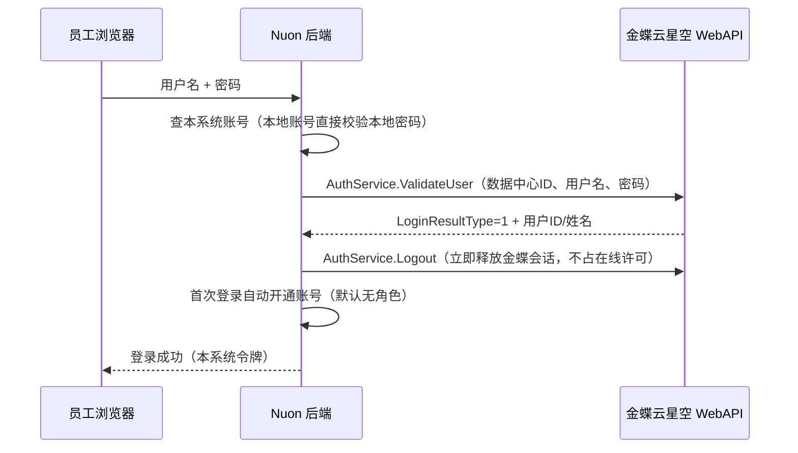

# 金蝶云星空账号登录（统一账号）

启用后，员工可以直接用 **金蝶云星空（K/3 Cloud）的用户名和密码** 登录本系统，无需另设密码。

## 工作原理

- **本系统不保存金蝶密码**，每次登录实时向金蝶校验：金蝶里改密码、停用账号立即生效。
- **首次登录自动开通**本系统账号，姓名取金蝶用户名称。为保障医疗器械质量数据安全，**默认不分配角色**，
  只能看到“欢迎/待分配角色”页面；管理员在「系统与合规 → 用户与角色」中分配岗位角色后即可使用。
  如需自动带默认角色（例如产线操作员），设置 `KINGDEE_DEFAULT_ROLES=operator`。
- **电子签名同样校验金蝶密码**（21 CFR Part 11 要求签名时再次验证本人身份）。
- **本地账号**（如 admin）始终使用本系统密码，金蝶服务器故障时仍可应急登录。
- 管理员也可以预先建好金蝶账号（登录方式选“金蝶云星空账号”，用户名与金蝶一致）并分配角色，员工首次登录即可直接使用。
- 登录成功/失败记录在审计追踪（对象“登录”）；同一账号连续 5 次失败锁定 15 分钟（`LOGIN_MAX_FAILURES` / `LOGIN_LOCK_MINUTES`）。

## 配置（后端环境变量）

| 变量 | 说明 | 示例 |
|---|---|---|
| `KINGDEE_ENABLED` | 1 = 启用 | `1` |
| `KINGDEE_URL` | 金蝶云星空站点地址（以 `/k3cloud/` 结尾） | 私有云 `http://192.168.1.10/k3cloud/`；公有云 `https://xxx.ik3cloud.com/k3cloud/` |
| `KINGDEE_ACCT_ID` | 数据中心 ID（账套 ID） | 在金蝶 **管理中心 → 数据中心列表** 查看“数据中心ID” |
| `KINGDEE_LCID` | 语言，默认 2052（简体中文） | `2052` |
| `KINGDEE_AUTO_CREATE` | 首次登录自动开通，默认 1；设 0 则只允许管理员预先开通的账号 | `1` |
| `KINGDEE_DEFAULT_ROLES` | 自动开通账号的默认角色，逗号分隔，默认空 | `operator` |
| `KINGDEE_TIMEOUT_MS` | 调用金蝶超时（毫秒），默认 8000 | `8000` |

Docker 部署时写在 `.env` 中即可（见 `.env.example`）。

## 上线前检查清单

1. **网络**：本系统服务器能访问金蝶站点（`curl -I $KINGDEE_URL` 返回 200/302）。公有云金蝶需允许本系统出口 IP（如有白名单）。
2. **接口可用**：金蝶云星空默认开放 WebAPI 登录接口；如贵司金蝶做过安全加固（如关闭了 WebAPI、启用了动态口令/短信二次验证），需与金蝶实施方确认 `ValidateUser` 可用。
3. **验证一个账号**：用一个普通金蝶账号登录本系统，确认姓名正确带出；再用错误密码确认提示“金蝶云星空：用户名或密码错误”。
4. **分配角色**：按岗位为员工分配角色（可批量预先开通）。
5. 金蝶强制改密/密码过期的账号需先在金蝶中完成改密后再登录本系统。

> 说明：接口按金蝶云星空官方 WebAPI（`Kingdee.BOS.WebApi.ServicesStub.AuthService.ValidateUser`）实现，并用模拟服务完成了自动化测试；
> 不同版本/部署方式的金蝶在细节上可能有差异，首次对接请按上面的清单在贵司环境实测一次。

## 常见问题

| 现象 | 原因 / 处理 |
|---|---|
| 提示“无法连接金蝶云星空服务器” | 网络不通、地址写错或金蝶服务停机；本地管理员账号仍可登录 |
| 提示“金蝶云星空：数据中心不存在” | `KINGDEE_ACCT_ID` 填错 |
| 登录成功但只看到欢迎页 | 账号尚未分配角色，请管理员分配 |
| 提示“该金蝶账号尚未开通本系统” | `KINGDEE_AUTO_CREATE=0`，请管理员先开通账号 |
| 本地账号与金蝶同名 | 以本系统账号的“登录方式”为准；如需改用金蝶密码，管理员把该账号登录方式改为“金蝶云星空账号” |
